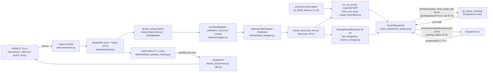

# g1-webcam-teleop: G1 arm and hand webcam teleoperation

This repository is the seated webcam teleoperation of the G1 arms and the BrainCo Revo2 hands. The operator
sits at a desk in front of an OBSBOT Tiny 3 webcam. No VR headset is used. The folder `xr_teleoperate/` is our
fork of unitreerobotics/xr_teleoperate (branch `hospital-g1-webcam`), checked out as a git submodule. The fork
adds a MediaPipe webcam input and a ROS 2 output backend to the upstream G1_29 arm IK and BrainCo
dex-retargeting.

The IK URDF comes from the sibling repository `g1-brainco-description`, found through `$HG1_ROOT`. The ROS 2
backend publishes to the mode manager in `hospital-sim-ros2`. The repository `hospital-sim-ui` shows the
annotated camera stream. The master repository `hospital-sim` checks out all of these repositories side by
side. Its file `env.sh` sets `HG1_ROOT` and sources ROS 2 Humble, the shared `.venv` and the `ros2_ws` overlay.

Run the commands in this README from the root of the master checkout. Paths are relative to this repository,
unless they name a sibling repository (`g1-brainco-description/...`) or a master file (`env.sh`,
`docs/interfaces.md`).

## How it works

The script `run_webcam_teleop.sh` sources `env.sh` and exports `OBSBOT_PY_PATH=obsbot`. It downloads the
MediaPipe `.task` models into `xr_teleoperate/teleop/webcam/models/` if they are missing. Then it runs
`xr_teleoperate/teleop/teleop_hand_and_arm.py --input-source webcam --backend ros2` with the flags that you
pass. The flag `--dry-run` means `--backend none`. One process owns the camera.

1. The tracker `webcam/tracker.py` opens the OBSBOT at 1280x720 MJPG 30 fps, detected automatically or set
   with `--camera /dev/videoN|clip.mp4|image.jpg`. A capture thread keeps only the newest frame. A processing thread resizes the frame to 960 px wide and runs MediaPipe Tasks on the CPU. The models
   are PoseLandmarker (lite, full or heavy, default full) and HandLandmarker with 2 hands. The tracker matches
   each hand to the arm with the nearest pose wrist.
2. The class `GimbalModel` in `obsbot/obsbot_ptz/camera.py` estimates the gimbal angle at exposure time. It
   uses the command history, a latency of 0.08 s and a rate limit. This is necessary because the camera reports
   the commanded target, not the live angle. The module `webcam/geometry.py` rotates every observation into the
   fixed base frame with `R_base_obs = R_gimbal(yaw, pitch) * R_ray(pixel)`. So a camera move does not move the
   arms of the robot.
3. The mapper `webcam/mapper.py` (`ArmHandMapper`) turns the shoulder, elbow, wrist and 21 hand landmarks per
   side into two outputs. The first output is a wrist SE(3) in the IK frame (pelvis, x forward, y left, z up).
   The second is 25 OpenXR hand keypoints in the Unitree hand frame. The mapper applies the calibration:
   shoulder-line yaw, arm length, neutral wrist offset and neutral palm rotation. It applies a One-Euro filter
   per axis (`webcam/one_euro.py`), with a harder filter on depth, and clamps the reach at 0.97 of the robot
   arm length. Confidence gating handles a lost hand: it holds for 0.5 s, eases to neutral over 2 s, and blends
   back over 0.4 s when found again.
4. The wrapper `webcam/tele_wrapper.py` (`WebcamTeleWrapper`) exposes `get_tele_data()` with the same `TeleData`
   fields as televuer. So the upstream main loop in `teleop_hand_and_arm.py` runs unchanged at 30 Hz
   (`--frequency`). The loop solves `G1_29_ArmIK` in `robot_control/robot_arm_ik.py`: CasADi/IPOPT over a
   pinocchio model of the g1-brainco-description IK URDF. The module `robot_control/casadi_kinematics.py`
   stands in for the missing `pinocchio.casadi` bindings. The loop writes the hand keypoints into shared arrays.
5. The backend `robot_control/ros2_backend.py` replaces the DDS arm and hand controllers. The class
   `Ros2ArmBackend` publishes the 14 arm joint targets plus three zero waist joints on
   `/g1/teleop/upper_body_target_raw` at 30 Hz. The class `RetargetHandBackend` runs the BrainCo
   dex-retargeting (nlopt) in a thread at 50 Hz. It normalises the result with the Revo2 ranges in
   `robot_control/brainco_retarget.py` and publishes `/g1/teleop/hand/{left,right}/cmd_raw` in contract order.
   A second thread publishes the annotated overlay as JPEG (quality 70) at up to 15 Hz on
   `/g1/teleop/camera/annotated/compressed`. It publishes a JSON status at 10 Hz on
   `/g1/teleop/tracking_status`. The backend subscribes to `/g1/mode` (shown in the overlay) and `/g1/teleop/key` (keys `c f h u`).
6. In parallel, the class `AutoFramer` in `obsbot/obsbot_ptz/auto_framing.py` keeps the union of the hand and
   forearm boxes centred. It uses a PI controller per axis and adjusts the zoom. The module `obsbot_ptz/camera.py`
   sends the result as UVC `pan_absolute`, `tilt_absolute` and `zoom_absolute` through `ioctl(VIDIOC_S_CTRL)`
   (`obsbot_ptz/v4l2.py`). It uses a second file descriptor of the same `/dev/videoN`.

The mode manager (`g1_teleop_manager` in `hospital-sim-ros2`) decides what reaches the robot. The backend
publishes the targets continuously. The mode manager forwards them only in MANIP (`m` in the keyboard node, `n`
to leave).

## Architecture



The table lists the main modules and scripts of this repository.

| Piece | File | Role |
|---|---|---|
| Launcher | `run_webcam_teleop.sh` | sources `env.sh`, fetches models, runs the teleop script with `--input-source webcam` and `--backend ros2` unless `--dry-run` or `--backend` is given |
| Main loop | `xr_teleoperate/teleop/teleop_hand_and_arm.py` | upstream entry point; the fork adds `--input-source`, `--backend`, `--dry-run`, `--camera*`, `--pose-model`, `--no-framing`, `--no-window`, `--ik-urdf`, `--use-sim-time`, `--auto-start`, `--idle-when-not-manip` |
| Tracker | `xr_teleoperate/teleop/webcam/tracker.py` | camera capture, MediaPipe pose + hands, hand to arm association, gimbal estimate, overlay, calls the mapper and framer |
| Geometry | `xr_teleoperate/teleop/webcam/geometry.py` | frames, rotations, ray model, wrist and hand frame conventions (pure numpy) |
| Mapper | `xr_teleoperate/teleop/webcam/mapper.py` | landmarks to wrist SE(3) and 25 hand keypoints; calibration, One-Euro, confidence and loss handling |
| Filter | `xr_teleoperate/teleop/webcam/one_euro.py` | One-Euro filter for vectors and rotations |
| Wrapper | `xr_teleoperate/teleop/webcam/tele_wrapper.py` | televuer-compatible `TeleData`, IK preview overlay, status JSON, key handling |
| ROS 2 backend | `xr_teleoperate/teleop/robot_control/ros2_backend.py` | contract publishers and subscribers, preview backend for `--dry-run`, in-process hand retargeting thread |
| Hand normalisation | `xr_teleoperate/teleop/robot_control/brainco_retarget.py` | Revo2 ranges, retarget order to contract order |
| IK | `xr_teleoperate/teleop/robot_control/robot_arm_ik.py`, `casadi_kinematics.py` | upstream G1_29 CasADi/IPOPT IK; symbolic FK shim for pip pinocchio |
| Hand retargeting | `xr_teleoperate/teleop/robot_control/hand_retargeting.py`, `dex-retargeting/` | upstream BrainCo dex-retargeting (unitree fork, editable install) |
| PTZ | `obsbot/obsbot_ptz/camera.py`, `v4l2.py` | UVC/V4L2 pan, tilt, zoom; `GimbalModel`, `SimulatedPTZ` when no controls are found |
| Auto-framing | `obsbot/obsbot_ptz/auto_framing.py` | PI centring, zoom rules, search sweep, soft limits |
| Hardware check | `obsbot/hw_check.py` | PTZ moves verified by image shift, return to centre, capture FPS |
| Tools | `xr_teleoperate/teleop/webcam/bench.py`, `virtual_gimbal_check.py` | FPS and latency benchmark; compensation-model experiment |

## Dependencies

Everything runs in the shared `.venv` of the master repository. The `.venv` uses system Python 3.10.12 with
system site-packages, so that rclpy works. The versions below are from the `.venv` freeze (`venv_local.txt`).

The system dependencies are:

| Item | Version | Why |
|---|---|---|
| Ubuntu | 22.04.5 LTS | |
| ROS 2 Humble | apt `ros-humble-desktop` 0.10.0 | `rclpy`, `sensor_msgs`, `std_msgs`; `rmw_cyclonedds_cpp` 1.3.5 (set by `env.sh`) |
| `g1_interfaces` | `ros2_ws` (hospital-sim-ros2) | `msg/Mode` for the `/g1/mode` subscription; optional, the node warns if `ros2_ws` is not built |
| uvcvideo kernel driver | kernel 6.8 | exposes the Tiny 3 UVC controls on `/dev/videoN`; no v4l-utils needed (ioctl from Python) |
| `curl` | | `webcam/fetch_models.sh` |
| `taskset` (util-linux) | | the launcher pins the process to CPUs 0-7 and 10-31 (logical CPUs 8 and 9 are defective on the dev machine) |
| OBSBOT Tiny 3 | USB 3564:ff02 | the only camera with PTZ support; any UVC camera works with `--no-framing` |
| OBSBOT SDK `libdev.so` v1.0.2 | `obsbot/obsbot-camera-control/sdk/v1.0.2/lib/` | shipped in the fork, not used at runtime (does not support the Tiny 3, see below) |
| git submodules | | `xr_teleoperate`, `obsbot/obsbot-camera-control`, `third_party/unitree_sdk2_python` |

The Python dependencies are the third-party imports of `obsbot/`, `xr_teleoperate/teleop/webcam/`,
`ros2_backend.py`, `brainco_retarget.py`, `robot_arm_ik.py`, `hand_retargeting.py` and
`teleop_hand_and_arm.py`:

| Package | Version | Used by |
|---|---|---|
| `mediapipe` | 1.0.1 | tracker (Tasks API, PoseLandmarker, HandLandmarker) |
| `opencv-contrib-python` | 4.10.0.84 | capture, overlay, JPEG encoding, ORB in `hw_check.py` |
| `numpy` | 1.26.4 | everywhere; must stay < 2 for ROS Humble |
| `pin` (pinocchio) | 3.9.0 | IK model, FK for the preview and the robot arm model; installed from a local wheel with `--no-deps` |
| `cmeel`, `cmeel-boost`, `eigenpy`, `cmeel-urdfdom`, `cmeel-tinyxml2`, `cmeel-assimp`, `cmeel-octomap`, `cmeel-qhull`, `cmeel-console-bridge`, `cmeel-zlib` | 0.61.0, 1.89.0, 3.12.0, 4.0.1, 10.0.0, 6.0.5, 1.10.0, 8.0.2.1, 1.0.2.3, 1.3.2 | pinocchio runtime, from the same wheel download |
| `casadi` | 3.8.1 | IK (IPOPT), `casadi_kinematics.py` |
| `meshcat` | 0.3.2 | upstream IK visualisation (`Visualization=True` only) |
| `dex_retargeting` | 0.4.7 | BrainCo hand retargeting; editable install from `xr_teleoperate/teleop/robot_control/dex-retargeting` |
| `torch` | 2.3.0+cpu | required by dex-retargeting (CPU wheel is enough) |
| `nlopt` | 2.7.1 | dex-retargeting optimiser (must be < 2.8) |
| `pytransform3d`, `trimesh`, `anytree`, `lxml`, `PyYAML` | 3.16.0, 5.1.0, 2.13.0, 6.1.3, 6.0.3 | dex-retargeting dependencies; `yaml` also read by `robot_arm_ik.py` |
| `logging-mp` | 0.2.5 | upstream logging |
| `sshkeyboard` | 2.3.1 | upstream terminal keys (skipped when there is no TTY) |
| `unitree_sdk2py` | 1.0.1 | native DDS path only (`--backend dds`); editable install from `third_party/unitree_sdk2_python` |
| `cyclonedds` | 0.10.2 | `unitree_sdk2py` dependency, built against `/opt/ros/humble` |
| `rclpy`, `sensor_msgs`, `std_msgs` | ROS Humble apt | not in `venv_local.txt`; system site-packages |
| `pytest` | 6.2.5 | system `python3-pytest`; unit tests |
| `televuer`, `teleimager` | not installed | upstream XR path only (`--input-source xr`) |

The file `requirements.txt` at the repository root pins the pip packages. The pinocchio wheel, the editable
installs and `unitree_sdk2py` need the extra steps under Install.

The data and assets that are not in git are:

| Asset | Where it comes from |
|---|---|
| MediaPipe models `pose_landmarker_{lite,full,heavy}.task`, `hand_landmarker.task` (float16) | `xr_teleoperate/teleop/webcam/fetch_models.sh` downloads them from `storage.googleapis.com/mediapipe-models` into `xr_teleoperate/teleop/webcam/models/` (5.8, 9.4, 30.7 and 7.8 MB) |
| IK URDF `g1-brainco-description/g1_29dof_brainco/urdf/g1_29dof_brainco_ik.urdf` | sibling repository, resolved through `$HG1_ROOT` (`--ik-urdf auto`); `--ik-urdf upstream` uses `xr_teleoperate/assets/g1/g1_body29_hand14.urdf` |
| dex-retargeting hand URDFs and configs | inside the `xr_teleoperate` submodule |

## Install

Run these commands from a fresh clone of `hospital-sim`, after `vcs import < hospital-sim.repos`.

```bash
git -C g1-webcam-teleop submodule update --init --recursive      # xr_teleoperate, obsbot-camera-control, unitree_sdk2_python
source env.sh
P=.venv/bin/pip
echo numpy==1.26.4 > /tmp/c.txt                                     # rclpy/rosidl need numpy 1.x
$P install -c /tmp/c.txt torch==2.3.0 --index-url https://download.pytorch.org/whl/cpu   # dex-retargeting needs torch (CPU is enough)
$P install -c /tmp/c.txt -r g1-webcam-teleop/requirements.txt
# pinocchio 3.x: the pip 'pin' wheels declare numpy>=2 (through cmeel-boost) but run fine on numpy 1.26
# (NumPy-2-built extensions are 1.x compatible). Download with deps, install without numpy:
$P download pin==3.9.0 -d /tmp/pinwhl && $P install --no-deps $(ls /tmp/pinwhl/*.whl | grep -v numpy)
$P install --no-deps "cmeel-urdfdom>=4,<5" "cmeel-tinyxml2>=10,<11"   # the resolver picks too-new ones
$P install --no-deps -e g1-webcam-teleop/xr_teleoperate/teleop/robot_control/dex-retargeting   # unitree fork (submodule)
# native DDS path only (real robot through unitree_sdk2):
CYCLONEDDS_HOME=/opt/ros/humble $P install cyclonedds==0.10.2 && $P install --no-deps -e g1-webcam-teleop/third_party/unitree_sdk2_python
g1-webcam-teleop/xr_teleoperate/teleop/webcam/fetch_models.sh                  # MediaPipe .task models (not in git)
(cd ros2_ws && colcon build --symlink-install) && source env.sh                # g1_interfaces for /g1/mode
```

These pins matter on Python 3.10:

- numpy < 2 (ROS Humble)
- opencv 4.10 (4.11 and later need numpy 2)
- nlopt < 2.8 (dex-retargeting)
- torch 2.3.0 (dex-retargeting pin; CPU wheel)

The pip package `pin` has no `pinocchio.casadi`. So the fork adds `robot_control/casadi_kinematics.py`, a
symbolic-FK stand-in built from the numeric model. It matches pinocchio to 1e-15. The upstream IK problem
(costs, IPOPT options) is unchanged. With a conda pinocchio that has CasADi bindings, the code uses the real
`cpin` automatically.

## Run

CAUTION: Turn off the AI tracking of the Tiny 3 on the camera before you teleoperate, because the two
controllers fight otherwise (see "OBSBOT control" below).

```bash
# 1. camera only: tracking + framing + overlay + IK preview; nothing is commanded, no ROS node
g1-webcam-teleop/run_webcam_teleop.sh --dry-run

# 2. simulation: run the simulator and the mode manager first (ros2 launch g1_bringup sim.launch.py), then
g1-webcam-teleop/run_webcam_teleop.sh                 # publishes the contract topics; add --use-sim-time if the stack runs on /clock
#    keyboard node: r (DAMP->STAND), m (STAND->MANIP) ... n (leave MANIP)

# 3. real robot, native unitree path (upstream behaviour, BrainCo hands over DDS; not yet tried on hardware)
cd g1-webcam-teleop/xr_teleoperate/teleop && python teleop_hand_and_arm.py --input-source webcam --backend dds --arm G1_29 --ee brainco
```

The table lists the flags that the script passes through to `teleop_hand_and_arm.py`.

| Flag | Effect |
|---|---|
| `--no-window` | no OpenCV window (headless; the UI shows the annotated stream) |
| `--no-framing` | OBSBOT auto-framing off |
| `--camera /dev/videoN\|clip.mp4\|image.jpg` | video source instead of the auto-detected OBSBOT |
| `--camera-size 1280x720` | capture size |
| `--pose-model lite\|full\|heavy` | MediaPipe pose model (default full) |
| `--ik-urdf auto\|upstream\|<path>` | IK model (default: the g1-brainco-description IK URDF) |
| `--use-sim-time` | stamp messages with `/clock` |
| `--idle-when-not-manip` | process every 3rd frame while `/g1/mode` is not MANIP |

The upstream XR path (`--input-source xr`, televuer) is unchanged.

Run the tools with these commands:

```bash
cd g1-webcam-teleop/xr_teleoperate/teleop && python -m webcam.bench --seconds 20      # FPS, capture->target latency, detection rates
python g1-webcam-teleop/obsbot/hw_check.py                                           # PTZ moves verified by image shift, return to centre, capture FPS
cd g1-webcam-teleop/xr_teleoperate/teleop && python -m webcam.virtual_gimbal_check --mode pose img.jpg   # compensation-model experiment
```

### Calibration

Calibrate once per session, and again when you change the chair position.

1. Sit so that your head, shoulders, elbows and both hands are visible. The camera frames you.
2. Hold the neutral pose. The neutral pose is: upper arms relaxed along the body, elbows bent about 90 degrees,
   forearms forward, palms facing each other, thumbs up, fingers open. This is the zero-arm pose of the G1, so
   the robot does not move when you calibrate.
3. Press `c` in the OpenCV window, or send `c` on `/g1/teleop/key` from the UI or the keyboard node. Both arms
   must be visible. The overlay says "calibrated", or says why the calibration failed.

The calibration stores four values:

- your shoulder-line yaw and roll, so you need not sit square to the camera;
- your arm length, which scales your reach to the 0.43 m arm of the G1;
- a position offset from your neutral wrist to the neutral wrist of the robot, which also absorbs the
  monocular depth bias;
- the neutral palm orientation; the wrist rotation is relative to it.

Press `u` to clear the calibration. Without calibration, the mapping uses a 0.55 m arm and the absolute palm
frame. This works, but it is less accurate.

### Controls

The table lists the keys of the OpenCV window.

| Key (OpenCV window) | Action |
|---|---|
| `c` | calibrate neutral pose (also accepted on `/g1/teleop/key`) |
| `f` | auto-framing on/off (also on `/g1/teleop/key`) |
| `h` | re-centre the camera (pan, tilt, zoom 0) (also on `/g1/teleop/key`) |
| `u` | clear calibration (also on `/g1/teleop/key`) |
| `r` | start following (upstream key; automatic for `--dry-run` and the ROS 2 backend) |
| `q` | quit (camera returns to centre) |

The mode keys (`m`, `n`, `x`, ...) belong to the keyboard node and the mode manager, not to this process.

## Test / check

```bash
source env.sh
cd g1-webcam-teleop/xr_teleoperate/teleop && python -m pytest -q webcam/tests     # 31 passed
cd g1-webcam-teleop/obsbot && python -m pytest -q tests                            # 12 passed
```

Both counts were confirmed on 2026-10-10. The tests cover:

- the landmark to wrist math and scaling, the reach clamp, and the 21 to 25 keypoint mapping;
- the palm and hand frame conventions, and the body and base axes;
- the gimbal compensation (a static operator under pan and tilt, exact for both models) and the ray geometry;
- the calibration (neutral to robot neutral, yaw removal, arm length) and the loss handling;
- the One-Euro filter;
- the contract hand order and names, the Revo2 normalisation, and an open against a curled hand through the
  real BrainCo retargeting;
- the CasADi FK shim against pinocchio;
- the framing controller in closed loop with the gimbal model, for these cases:
  - centring without overshoot;
  - rate limit;
  - deadband against jitter;
  - following;
  - zoom in and out;
  - hold to search to park;
  - hard limits;
- the PTZ unit and sign conversion.

The end-to-end test runs with the MuJoCo simulator. Use your own `ROS_DOMAIN_ID`, for example 63, and stop
every node after a test.

1. Run `ros2 launch g1_bringup sim.launch.py world:=hospital viewer:=false`.
2. Run this script with `--camera some_image.jpg --no-window`.
3. Send the keys `r` and `m` on `/g1/teleop/key`.

CAUTION: Keep the test poses moderate, because big two-arm forward reaches can topple the placeholder policy.

The test passed on 2026-09-29 with these results:

- the mode manager forwarded the targets in MANIP;
- the simulator arm joints converged to the published IK targets within 0.03 to 0.08 rad;
- `/g1/hand/left/state` equalled our `cmd_raw` in contract order;
- `n` returned the robot to STAND.

Nothing has been run on the real robot.

## Layout

The table lists the files and folders of this repository.

| Path | What |
|---|---|
| `run_webcam_teleop.sh` | launcher (ROS 2 backend by default, `--dry-run` for camera only) |
| `requirements.txt` | pip pins for the shared `.venv` (see Install for the wheel and editable steps) |
| `xr_teleoperate/` | submodule: fork of unitreerobotics/xr_teleoperate, remote `upstream`, branch `hospital-g1-webcam` |
| `xr_teleoperate/teleop/teleop_hand_and_arm.py` | upstream main loop with the webcam and backend flags |
| `xr_teleoperate/teleop/webcam/` | `tracker.py`, `mapper.py`, `geometry.py`, `one_euro.py`, `tele_wrapper.py`, `bench.py`, `virtual_gimbal_check.py`, `fetch_models.sh`, `models/` (downloaded), `tests/` |
| `xr_teleoperate/teleop/robot_control/ros2_backend.py` | ROS 2 contract output and dry-run preview backend |
| `xr_teleoperate/teleop/robot_control/brainco_retarget.py` | Revo2 normalisation and contract order |
| `xr_teleoperate/teleop/robot_control/casadi_kinematics.py` | symbolic FK stand-in for `pinocchio.casadi` |
| `xr_teleoperate/teleop/robot_control/dex-retargeting/` | upstream BrainCo retargeting (editable install) |
| `obsbot/obsbot_ptz/` | `camera.py` (UVC PTZ, `GimbalModel`), `v4l2.py` (ioctl), `auto_framing.py` (`AutoFramer`) |
| `obsbot/hw_check.py`, `obsbot/tests/` | hardware check; framing-controller tests |
| `obsbot/obsbot-camera-control/` | submodule: fork of aaronsb/obsbot-camera-control, remote `upstream`, branch `hospital-g1`; ships the OBSBOT SDK `libdev.so` v1.0.2 and `tools/sdk_probe.cpp` |
| `third_party/unitree_sdk2_python/` | submodule: unitree_sdk2py (native DDS path only) |

## Interfaces to other repositories

The contract is `docs/interfaces.md` in the master repository (section 3, teleop and arbitration).

This repository reads:

| From | What |
|---|---|
| `g1-brainco-description` | `g1_29dof_brainco/urdf/g1_29dof_brainco_ik.urdf` (fallback `g1_29dof_brainco.urdf`) through `$HG1_ROOT`; `g1_29dof_brainco/robot_spec.json` is the source of the Revo2 ranges hard-coded in `brainco_retarget.py` |
| `hospital-sim-ros2` | `g1_interfaces/msg/Mode` on `/g1/mode` (transient local); `/g1/teleop/key` (`std_msgs/String`, keys `c f h u`) |

The ROS 2 backend provides these topics, all under `/g1/teleop/`:

| Topic | Content |
|---|---|
| `/g1/teleop/upper_body_target_raw` | `sensor_msgs/JointState`, 17 names: `waist_{yaw,roll,pitch}_joint` (always 0) + 14 arm joints `left_shoulder_pitch_joint` ... `right_wrist_yaw_joint`; positions in rad, 30 Hz; consumed by `g1_teleop_manager` |
| `/g1/teleop/hand/{left,right}/cmd_raw` | `sensor_msgs/JointState`, 6 values 0 (open) to 1 (closed) in contract order thumb, thumb_aux, index, middle, ring, pinky; names `<side>_thumb_proximal_joint, <side>_thumb_metacarpal_joint, <side>_{index,middle,ring,pinky}_proximal_joint`; 50 Hz |
| `/g1/teleop/camera/annotated/compressed` | `sensor_msgs/CompressedImage` jpeg, frame_id `teleop_camera`, 960x540 overlay (skeleton, hands, framing box, mode, status, IK preview), up to 15 Hz (about 14 Hz measured); consumed by `hospital-sim-ui` |
| `/g1/teleop/tracking_status` | `std_msgs/String` JSON, 10 Hz: contract keys `hands_visible`, `arms_visible`, `fps`, `framing` (`tracking\|searching\|off`) plus `framing_detail` (`tracking\|holding\|searching\|off`), `calibrated`, `latency_ms`, `confidence` (per side arm and hand score and state `live\|hold\|easing\|neutral`), `ptz` (`yaw_right_deg`, `pitch_up_deg`, `zoom`), `mode`, `message` |

The hand normalisation uses the Revo2 ranges (thumb_proximal 1.047, thumb_metacarpal 1.553, fingers 1.41 rad).
The upstream DDS path sends thumb_metacarpal to BrainCo motor 0. This contradicts the BrainCo motor table,
where motor 0 is thumb flexion. The native path keeps the upstream behaviour; check it on the real hand. The
ROS topics use the contract order above.

## OBSBOT control through UVC and V4L2

- The OBSBOT SDK bundled with the fork (libdev v1.0.2) does not support the Tiny 3. It finds the camera, but
  the device init fails (`getDevUuidR ret -3`, see `obsbot/obsbot-camera-control/tools/sdk_probe.cpp`). A
  pybind11 or ctypes shim over the SDK would not work.
- The Tiny 3 exposes the standard UVC camera-terminal controls through uvcvideo: `pan_absolute` +-468000
  arcsec (1 degree steps), `tilt_absolute` +-324000, `zoom_absolute` 0..100. The module
  `obsbot/obsbot_ptz/v4l2.py` drives them with plain `ioctl(VIDIOC_S_CTRL)` from Python, with no apt package
  and no root. It uses a second file descriptor, while OpenCV streams from the same device node in the same
  process.
- The measurements on this unit are:
  - +pan turns the camera left and +tilt turns it up; the layer exposes `yaw_right` and `pitch_up`;
  - about 17.4 px/deg at 1280 px (f about 975 px, HFOV about 67 degrees);
  - zoom 30 is about 1.85x;
  - the motion starts about 0.08 s after a command, at 10 to 12 deg/s for large steps;
  - pan repeats to +-1 px; tilt returns within 0.5 to 1.7 degrees (some hysteresis);
  - capture 29.8 fps at 1280x720 MJPG.
- The read-back returns the last commanded target, not the live angle, because uvcvideo and the device report
  the target instantly. The compensation therefore uses `GimbalModel` (command history + latency + rate limit),
  evaluated at the exposure time of each frame. The framer limits itself to 8 deg/s so that the model stays
  valid.
- The AI tracking of the Tiny 3 cannot be disabled from Linux. It is not a UVC control, and the SDK does not
  talk to the Tiny 3. Turn it off on the camera (hand gesture or the OBSBOT Center app) before you teleoperate.
  Our absolute commands override it only for a moment. If it is on, the two controllers fight and the
  compensation model is wrong.

## Auto-framing (`obsbot/obsbot_ptz/auto_framing.py`)

The module `obsbot/obsbot_ptz/auto_framing.py` keeps the union of the hand boxes and the elbow-to-wrist forearm
boxes at the image centre. A PI controller per axis does this. Its input is the desired absolute angle
(estimated current pose + image error) minus the commanded target, so the gimbal lag does not cause overshoot.
The controller limits are:

- a deadband of 3 degrees to start and 1 degree to stop (the hardware step is 1 degree);
- a rate of at most 8 deg/s;
- an acceleration of at most 30 deg/s^2.

The zoom rules are:

- zoom out fast (30/s) when any fingertip is within 5 % of an edge;
- zoom out (12/s) when the union box exceeds 72 % of the frame;
- zoom in slowly (5/s) when the union box is below 40 % of the frame.

When the hands are lost, the framer holds for 1 s. Then it zooms out and sweeps the yaw +-25 degrees at
6 deg/s, with the pitch at -5 degrees. After 25 s it parks at home. The soft limits are yaw +-60 degrees, pitch
-35 to +30 degrees and zoom 0 to 60.

## Gimbal compensation and the ray model

MediaPipe estimates the world landmarks from a crop around the person or the hand. A camera rotation changes
where the person is in the image, but it hardly changes the content of the crop. So the 3D output stays about
relative to the ray through the crop, not to the optical axis. The code therefore rotates the observations to
the fixed base frame with `R_base_obs = R_gimbal(yaw, pitch) * R_ray(pixel of shoulders / hand centre)`. The
script `webcam/virtual_gimbal_check.py` re-renders sample images as seen after +-20 degrees of pan and +-10
degrees of tilt. The table shows the result for each model.

| Model | Pose: wrist-shoulder vector change | Hands: palm orientation change |
|---|---|---|
| no compensation | 2.9 cm | 7.7 degrees |
| pan/tilt rotation only (naive) | 10.1 cm | 11.3 degrees |
| pan/tilt + ray (used) | 3.2 cm | 8.1 degrees |

The naive rotation would itself move the arms of the robot when the camera moves. The ray model keeps them
within the noise of MediaPipe itself. Unlike "no compensation", it also accounts for an operator who is
off-centre in the image. Two limits remain. The roll error is 2 to 5 degrees for combined pan and tilt (the
yaw-then-pitch crop model). The estimate uses the commanded-angle model, not a measured angle.

## Known limits (monocular)

- Depth (forward and back) is the weakest axis. MediaPipe learns its z value; it does not measure it, so the
  value has a few cm of noise and a scale bias. The code filters depth harder (One-Euro minimum cutoff 0.4 Hz
  against 1 Hz), `MapperConfig.depth_gain` can scale it down, and the calibration removes the static bias.
  Expect forward and back reaches to be less precise than side and up-down reaches.
- The metric scale comes from the body and hand priors of MediaPipe. The arm length from the calibration
  rescales it.
- Wrist roll with the palm facing the camera is ambiguous. Fingers that occlude each other (a fist, or a pinch
  seen edge-on) are also ambiguous. The retargeted finger values are noisier than with an XR headset.
- The hands must be visible. A hand lost for more than 0.5 s holds its target, then eases to neutral (open
  hand, zero-arm pose) over 2 s. When the hand is found again, the mapper blends back over 0.4 s.
- The waist, torso and head are not teleoperated, because the operator is seated. The waist targets are
  always 0.
- CPU load: about 27 fps with nobody in view, and 20 to 25 fps with a pose and two hands. The latency is 25 to
  55 ms from capture to target.

## License

The license of this repository is the Apache License, Version 2.0 (see `LICENSE`).
You can use, change and share this work, also for commercial use.
If you share this work or a work that you built on it, keep the `NOTICE` file.
Give this credit in your documentation and product credits: "Based on hospital-sim by Bkrakshith (https://github.com/Bkrakshith/hospital-sim)".
To cite this work in a publication, use `CITATION.cff`.
Some third-party parts keep their own licences. The `NOTICE` file lists them.
